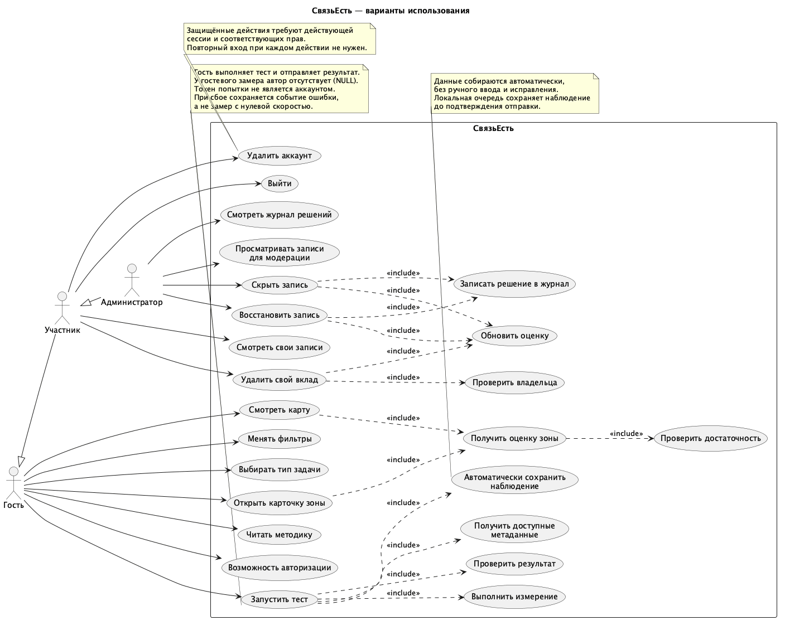
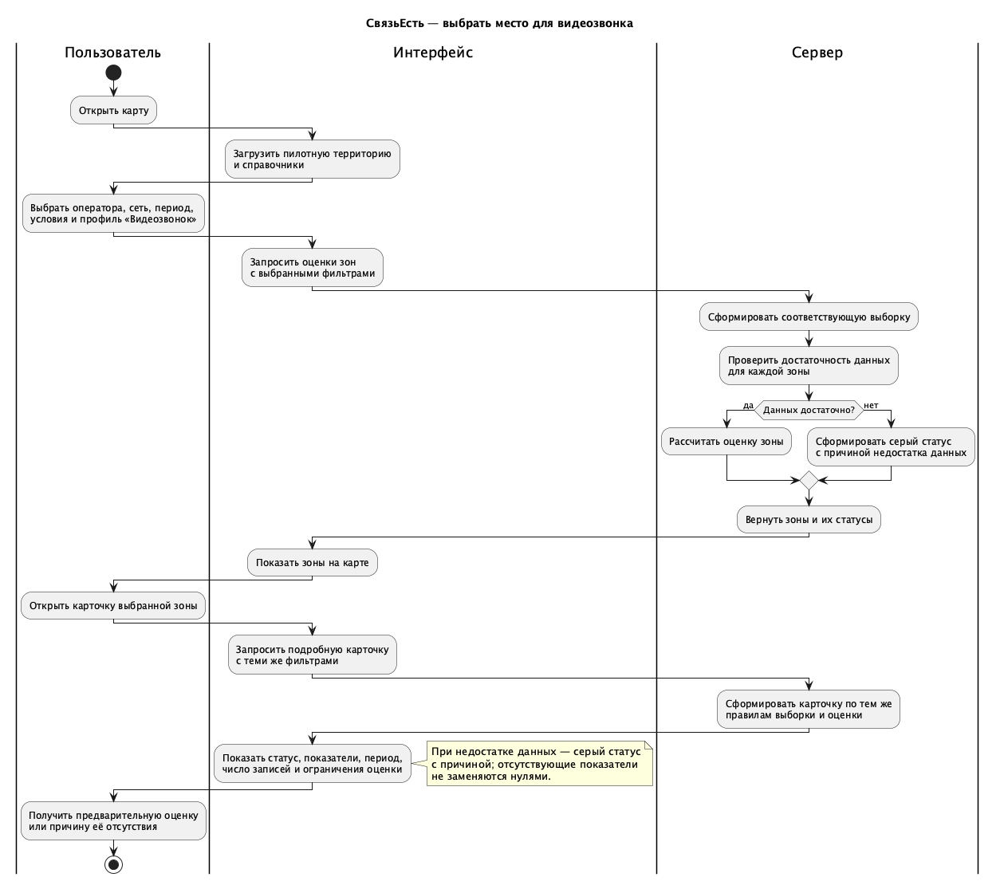
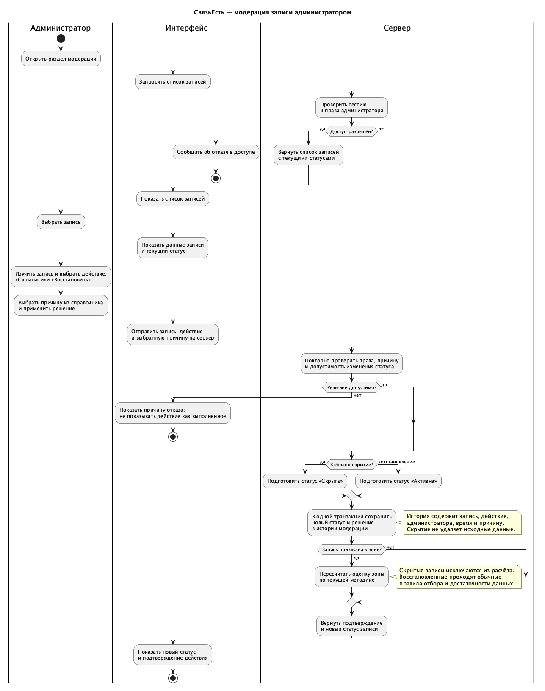
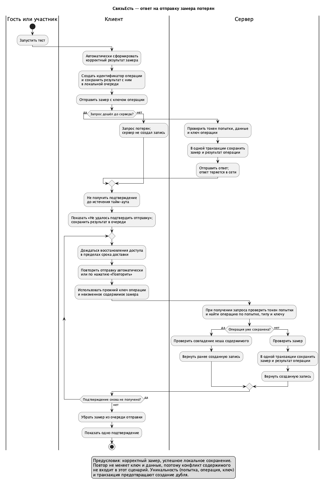

# Структурная схема системы (лаба 2)

Верхнеуровневое представление состава подсистем и модулей, их ответственность
на текущей итерации (прототип: клиент + демо-данные, без сервера).

```text
Приложение «Связь Есть»
│
├── Клиентское приложение (apps/web) — интерфейс пользователя
│   ├── Карта зон: подложка OpenStreetMap, квадраты зон с цветом статуса,
│   │   фильтры, карточка зоны с объяснением оценки
│   ├── Экран теста связи: запуск замера, ход, результат или ошибка
│   └── Экран методики: правила оценки зон
│
├── Демо-адаптер данных — поставляет данные интерфейсу
│   ├── Демо-наблюдения (Ижевск) и справочники операторов
│   └── Симулятор замера связи
│
├── Пакет контрактов (packages/contracts) — общие типы и правила обмена данными
│   └── Описания структур, проверка корректности входных данных
│
└── Пакет расчёта (packages/domain) — бизнес-правила
    ├── Сетка зон: деление территории пилота на квадраты
    └── Оценка зоны: фильтрация, дедупликация, достаточность, статус
```

## Ответственность подсистем

| Подсистема | Ответственность |
|---|---|
| Клиентское приложение | Отобразить карту зон и результаты, принять фильтры, провести тест связи |
| Демо-адаптер данных | Выдать интерфейсу наблюдения, справочники и результаты теста вместо сервера |
| Пакет контрактов | Единые структуры данных и проверка их корректности для клиента и адаптера |
| Пакет расчёта | Пересчитать наблюдения в статус и метрики зоны по методике |

## Связи между подсистемами

```text
Клиентское приложение → Пакет контрактов → Демо-адаптер данных → Пакет расчёта
```

Клиент обращается к данным только через контракт; расчёт оценок находится в
отдельном пакете, а не в интерфейсе. Замена демо-адаптера на сервер не меняет
остальные подсистемы.

## Технологический стек

| Часть | Выбор | Обоснование |
|---|---|---|
| Язык | TypeScript | Общие типизированные сущности на клиенте и сервере |
| Интерфейс | React | Быстрота разработки, удобство |
| Сборка прототипа | Vite | Лёгкий и простой сборщик |
| Навигация | React Router | Основная библиотека для роутинга реакта |
| UI kit | Mantine 7 | Не нужно разрабатывать свой UI-kit |
| Карта | Leaflet + OpenStreetMap | Удобно и просто в подключении и использовании, не требует API токена |
| Тесты | Vitest | Детерминированные unit-тесты ядра с фиксированным временем |
| Сервер (план) | NestJS | Модули, контроллеры и сервисы с явными границами |
| Хранилище (план) | PostgreSQL + PostGIS | Связанные сущности, транзакции, пространственные запросы |
| Контракт API (план) | REST, JSON, OpenAPI | Явное описание запросов, ответов и ошибок |

Строки «(план)» — этапы 7–8 плана реализации, сейчас их кода нет. Полная
версия раздела с техническими основаниями — architecture.md §2.

## UML-диаграммы

Источники — `docs/diagrams/` (PlantUML; рядом с каждым `.puml` лежат `.png` и
`.svg` для вставки в отчёт).

### Диаграмма вариантов использования



`01-use-cases.puml` / `01-use-cases.svg`

Актёры: Гость → Участник → Администратор (наследование ролей).
Основные сценарии: просмотр карты с фильтрами и профилем задачи, карточка
зоны с оценкой и проверкой достаточности, чтение методики, запуск теста
связи с автоматическим сбором метаданных, сохранение наблюдения, свои
записи и удаление вклада, модерация администратором.

### Диаграммы активности



`02-select-location.puml` / `02-select-location.svg` — выбор места для
видеозвонка (US-01–04): пользователь → интерфейс → сервер. Фильтры,
запрос оценок зон, показ зон и карточки, различение «нет данных» и
«недостаточно данных».



`03-admin-moderation.puml` / `03-admin-moderation.svg` — модерация записи
администратором (US-09): проверка сессии и прав сервером, скрытие и
восстановление с причиной, пересчёт затронутой зоны; чужие изменения
запрещены.



`04-measurement-retry.puml` / `04-measurement-retry.svg` — ответ на отправку
замера потерян (US-12, NFR-07): ключ идемпотентности операции, локальная
очередь, повторная доставка, исключение дублей.

## Интерфейсы взаимодействия компонент

Контракты заданы в `packages/contracts`: типы данных, проверка корректности
(zod-схемы) и интерфейс шлюза данных. Расчётное ядро — `packages/domain`.

### Основные структуры данных

| Структура | Поля | Смысл |
|---|---|---|
| `MeasurementInput` | `attemptId`, `testSessionId`, `occurredAt`, `cellId`, `operatorId`, `networkType`, `transport`, `vpn`, `environment`, `downloadMbps`, `uploadMbps`, `rttMs` | Результат успешного теста. Лишние поля (например, `authorId`) отклоняются — авторство назначает сервер |
| `FailureEventInput` | те же метаданные + `stage`, `errorCode` | Неудачный тест. Поля скоростей отсутствуют — пропуск не равен нулю |
| `ObservationReceipt` | `id`, `attemptId`, `kind`, `status`, `submittedAt` | Квитанция о приёме записи |
| `CellFilters` | `operatorId`, `networkType`, `environment`, `profileCode`, `periodFrom`, `periodTo` | Группа фильтров: карта и карточка всегда согласованы |
| `CellSummary` | `status`, `metrics`, `sampleCount`, `complaintCount`, `lastMeasurementDate`, `reasonCodes` | Оценка зоны: цвет, метрики, объяснение статуса |
| `GridConfig` | `gridVersion`, `cellSizeMeters`, `projectionParams`, `pilotBoundary` | Параметры сетки и границы пилота |

### Интерфейс шлюза данных `DataGateway`

Единая точка доступа интерфейса к данным; демо-адаптер и будущий HTTP-клиент
реализуют один и тот же контракт:

```text
getGrid(signal)                                  → GridConfig
getCatalog(signal)                               → CatalogResponse
getMapCells(filters, bbox?, signal)              → MapCellsResponse
getCellSummary(cellId, filters, bbox?, signal)   → CellSummary
createTestSession(input, token, idempotencyKey)  → TestSession
submitObservation(input, token, idempotencyKey)  → ObservationReceipt
```

`bbox` — видимая область карты: данные нарезаются по окну просмотра.
`idempotencyKey` — ключ операции: повтор запроса возвращает прежний
результат без дублей. `signal` — отмена запроса.

### Сигнатуры расчётного ядра `packages/domain`

```text
resolveCell(point, grid)          → cellId | null   координаты → ячейка (или вне пилота)
cellPolygon(cellId, grid)         → GeoJSON-кольцо  геометрия для карты
cellIndexAt(point, grid)          → {column, row}   индексы без проверки границы
parseCellId / formatCellId        → CellRef         разбор и сборка идентификатора
evaluateCell(input)               → CellSummary     главная функция оценки
```

`evaluateCell` принимает наблюдения одной ячейки, фильтры и текущее время,
возвращает статус и метрики. Функция чистая: без React, HTTP и БД, детерминирована
при фиксированном времени — на неё написаны unit-тесты границ методики.

### Формат обмена

Данные передаются в JSON; GeoJSON `FeatureCollection` для карты
(полигоны ячеек со статусами). Входные записи проверяются схемами:
неизвестные поля и некорректные значения (отрицательная скорость и т.п.)
отклоняются с кодом `VALIDATION_ERROR`, а не приводятся к значениям по умолчанию.

## Архитектурные решения (ADR)

### ADR-001: Архитектурный стиль — монорепозиторий с чистым ядром и подменяемым адаптером данных

**Статус:** Принято

**Контекст.** Требования ЛР 1: US-01–04 (карта с фильтрами и карточкой зоны),
US-06–08 (сбор наблюдений и оценка зоны), US-17 (speed test), NFR-08 (пересчёт
≤60 с). Сервер по плану появляется на этапах 7–8, а прототип должен быть
запускаемым уже сейчас. Команда — два человека, проект учебный.

**Рассмотренные альтернативы:**
1. Вся логика внутри React-приложения — расчёт методики в JSX нельзя
   тестировать отдельно и перенести на сервер без копипасты.
2. Сразу писать сервер (NestJS) — задерживает запускаемый прототип, требуемый
   ЛР 2.
3. Микросервисы — избыточно для двух разработчиков и учебного проекта.

**Принятое решение.** Монорепозиторий на npm workspaces: `apps/web` — интерфейс
без бизнес-расчётов; `packages/contracts` — типы, zod-схемы и интерфейс шлюза
`DataGateway`; `packages/domain` — чистое ядро методики (`evaluateCell`, сетка),
не зависящее от React, HTTP и БД. Клиент обращается к данным только через
`DataGateway`; демо-адаптер заменяется HTTP-клиентом с тем же контрактом без
изменения UI.

**Последствия.** Упрощается: unit-тесты методики с фиксированным временем,
переиспользование ядра сервером, замена источника данных. Усложняется: три
пакета вместо одного приложения — workspace-каркас и общий typecheck. Риски:
демо-адаптер может «прирасти» к UI, если компоненты начнут импортировать его
напрямую — граница держится контрактом.

**Роль агента.** Агент предложил разбиение на три пакета и правило «расчёт не
в JSX», сгенерировал сравнение вариантов. Студент выбрал объём итерации
(«фундамент + карта»), UI-набор и порядок этапов; позже скорректировал решение
о подсистеме карты (ADR-003). Демо-адаптер как «временный сервер с тем же
контрактом» — предложение агента, принятое студентом без правок.

### ADR-002: Хранение данных — PostgreSQL + PostGIS на целевой системе, память в прототипе, ячейка — поле наблюдения

**Статус:** Принято

**Контекст.** Требования ЛР 1: US-06–08, US-09 (модерация с журналом), US-10
(удаление данных, NFR-05), NFR-02 (100 тыс. записей, p95 ≤1 с), NFR-08.
Замеры геопривязаны — нужны пространственные запросы по видимой области.
В прототипе сервера ещё нет (ADR-001), данные демо-генерируются.

**Рассмотренные альтернативы:**
1. MongoDB — слабая поддержка пространственных запросов и транзакций; модель
   реляционная.
2. SQLite — не соответствует NFR-02, нет пространственного расширения уровня
   PostGIS.
3. Отдельная таблица ячеек (`grid_cells`) — отклонена при переходе на
   динамическую сетку: границы вычисляются, а не хранятся (ADR-005).

**Принятое решение.** Целевое хранилище — PostgreSQL с PostGIS: 8 таблиц,
пространственный индекс границы пилота, транзакционная запись «наблюдение +
квитанция». Идентификатор ячейки — текстовое поле `cell_id` на наблюдении
(«версия:столбец:ряд») с индексом для группировки; таблицы квадратов нет. В
прототипе хранилище заменено демо-адаптером в памяти с тем же контрактом;
перенос на PostgreSQL — этап 7 плана.

**Последствия.** Упрощается: запуск без инфраструктуры, минимальная схема.
Усложняется: валидность `cell_id` держится схемой контракта, а не внешним
ключом; при смене сетки нужен `gridVersion` в идентификаторе. Риски: при росте
данных агрегатам потребуется кэш ради p95 ≤1 с.

**Роль агента.** Агент предложил PostgreSQL + PostGIS в ЛР 1 и сравнил с
MongoDB/SQLite; при пересмотре указал противоречие таблицы квадратов с
динамической сеткой и предложил текстовый `cell_id`. Решение «динамическая
сетка» — студенческое; агент оценил его последствия для методики. Разделение
«целевое хранилище / память в прототипе» — предложение агента, принятое без
изменений.

### ADR-003: Картографическая подложка — Leaflet + OpenStreetMap вместо Яндекс Карт

**Статус:** Принято (заменяет первоначальный выбор Яндекс Карт JS API v3)

**Контекст.** Карта — основной экран (US-01–04, US-11): полигоны ячеек поверх
подложки. Первая редакция архитектуры выбирала Яндекс Карты v3 по API-ключу.
Ключ так и не активировался: API отдавал «403 Invalid api key» при статусе
«активен» в кабинете; ограничения по Referer принимают только домены без порта,
что ломает локальную разработку; активация до 15 минут. Прототип должен
запускаться без внешних ключей.

**Рассмотренные альтернативы:**
1. Продолжить с Яндексом — интеграция блокирована внешним сервисом, риск
   повторяется при каждом новом домене или смене тарифа.
2. MapLibre GL — мощнее, но выше порог входа и избыточен для полигонов поверх
   схемы.
3. Подложка без карты (только полигоны) — теряется контекст города, US-01
   предполагает привычную карту.

**Принятое решение.** Тайлы OpenStreetMap через Leaflet: без API-ключей,
атрибуция OSM обязательна по лицензии. Полигоны строятся из GeoJSON собственных
модулей (библиотека не участвует в расчёте цвета и не получает точных координат
замеров), рендер — canvas для сотен полигонов. Согласовано 15.11.2026; меняется
только модуль карты, контракты и ядро не тронуты.

**Последствия.** Упрощается: запуск и развёртывание без ключей, проверка на
статическом хостинге. Усложняется: своя интеграция полигонов; локализация
тайлов хуже яндексовской. Риски: лимиты публичных тайлов OSM при росте трафика —
для пилота рассмотреть свой тайл-сервер или коммерческого провайдера.

**Роль агента.** Исходный выбор Яндекса — из документации ЛР 1; агент подключал
интеграцию, диагностировал отказ (403, ORB, ограничения формы кабинета) и
предложил список альтернатив. Студент выбрал Leaflet + OSM и сформулировал
требования к демо (Ижевск, плотные мок-данные, динамическая сетка 25×25 с
пересчётом на лету). Агент реализовал провайдер, сохранив контракт карты.

### ADR-004: Параметры методики оценки зон — окно 30 дней, веса с полупериодом 14 дней, пороги 0.8/0.5, гостевые замеры участвуют

**Статус:** Принято

**Контекст.** Требования ЛР 1: US-08 (оценка зоны), US-04 (карточка с
объяснением), NFR-08, US-07 (сбой — не нулевой замер). Параметры — стартовые
гипотезы до калибровки: старение вкладов, достаточность выборки, пороги
профилей (базовая ≥1/≥0.5 Мбит/с, RTT ≤300 мс; видеозвонок ≥5/≥3 Мбит/с,
RTT ≤150 мс).

**Рассмотренные альтернативы:**
1. Простое среднее без весов и окна — старые данные маскируют текущее состояние
   сети.
2. Порог «только аккаунты» — гость основной пользователь пилота; противоречит
   решению ЛР 1 «гостевые участвуют в цвете».
3. Нулевые скорости при сбое — сбой это отсутствие данных, а не медленная связь;
   смешение ломает средние. Итог — отдельный вид записи «событие ошибки».

**Принятое решение.** Методика `2-guest-draft` как чистая функция `evaluateCell`:
окно 30 дней; вес `2^(−возраст_дней/14)`; достаточность ≥5 замеров из разных
сессий за ≥2 даты, иначе `insufficient_data` с кодами причин; дедуп — известный
автор один вклад в сутки (в TZ пилота), гость — один итог на сессию; допуск:
`cellular`, оператор известен, VPN не обнаружен; цвет по взвешенной доле
прошедших: зелёная ≥0.8, жёлтая ≥0.5, красная ниже, границы включительные;
средние отдельно от цвета; события ошибок — в `complaintCount`, не в скорости.
Параметры вынесены в `MethodologyConfig`.

**Последствия.** Упрощается: объяснение статуса (reasonCodes), детерминированные
тесты границ, смена порогов без правки логики. Усложняется: аккуратная работа с
часовыми поясами и полуинтервалом периода; параметры — гипотезы до калибровки
(этап 10). Риски: на старте много серых зон из-за плотности данных.

**Роль агента.** Агент перевёл требования в формальные правила, спроектировал
структуру `evaluateCell` и написал тесты граничных случаев. Студент утвердил
параметры и корректировал пограничную семантику, найденную тестами агента
(включительность порогов, смешение периода фильтра с окном). Решение «гостевые
участвуют в цвете» — студенческое из ЛР 1; агент обеспечил его выполнение в коде
и демо-наборах.

### ADR-005: Упрощение модели данных — 13 → 8 таблиц

**Статус:** Принято

**Контекст.** Первая редакция ER-модели содержала 13 таблиц. Сервер — этапы 7–8,
команда — два человека. Требования ЛР 1: US-09, US-10 (NFR-05), US-12
(идемпотентная повторная отправка), US-06–07 (наблюдения двух видов). Каждая
таблица должна отвечать на вопрос «что сломается без неё».

**Рассмотренные альтернативы:**
1. Оставить 13 таблиц — четыре обслуживают гипотетические сценарии, которых нет
   в требованиях пилота.
2. Слить замеры и события ошибок в одну таблицу с nullable-колонками — «пропуск
   ≠ ноль» перестаёт гарантироваться схемой; детали остаются двумя таблицами с
   XOR-связью по `kind`.
3. Хранить журнал удалений отдельно от модерации — дублирование структуры,
   усложнение аудита.

**Принятое решение.** Схема сокращена до 8 таблиц: users, sessions,
test_sessions, operators, observations, measurement_details, complaint_details,
moderation_actions. Удалены: `grid_cells` (ячейка — поле наблюдения, ADR-002);
`idempotency_requests` (повтор ловится `UNIQUE(attempt_id)` + проверкой токена);
`methodology_versions`, `task_profiles` (методика — конфигурация кода);
`deletion_events` (объединена с модерацией в «журнал решений»: `target_type`,
`target_id`, `moderator_id` NULL для самоудаления, `purge_after`).

**Последствия.** Упрощается: миграции и сопровождение; аудит — один журнал.
Усложняется: появление живого редактирования методики потребует вернуть таблицу
версий (миграция); идемпотентность ограничена попыткой теста. Риски: полиморфная
ссылка журнала без внешнего ключа — целостность на стороне кода; `cell_id`
валидируется схемой контракта.

**Роль агента.** Агент провёл ревью первой редакции (11.11.2026): указал на
перебор таблиц и предложил кандидатов на удаление (`idempotency_requests`,
`methodology_versions`, `task_profiles`). Студент принял часть предложений,
отклонил объединение таблиц деталей (сохранил XOR-структуру) и сам предложил
два сокращения, которых агент не предлагал: удаление таблицы ячеек и слияние
журнала удалений с модерацией. Агент исполнил изменения в диаграмме и документе;
итог согласован 25.11.2026.


